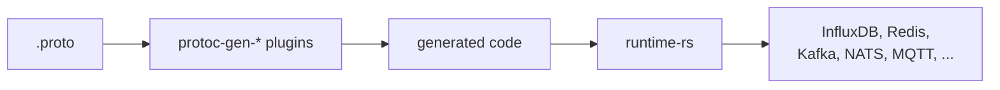

<!-- Generated by tools/docgen from Cargo metadata. Do not edit by hand: -->
<!-- run `just docs` instead. Module usage and code examples live in -->
<!-- each folder's README.md and in the crate's rustdoc. -->

# runtime-rs

[](https://github.com/the-protobuf-project/runtime-rs/actions/workflows/ci.yaml)
[](LICENSE)

**The Rust runtime underneath code generated from your `.proto` files.**

The protobuf project's plugins turn a proto service into storage, messaging, APIs and agent tools. What they generate is thin: names, types and specs. The work happens here, in small traits with a driver for each backend, so a program written against one database or broker moves to another by changing one line. It is the Rust twin of [runtime-go](https://github.com/the-protobuf-project/runtime-go), built the Rust way rather than as a line-for-line translation, and the two agree on the wire: a message a Go program publishes, a Rust one receives, and a trace started in one continues in the other.



## Start here

| I want to | Crate | Go twin |
| --- | --- | --- |
| Let AI agents call a service over MCP or A2A | [`agents`](agents) | `runtime-go/agents` |
| Cache records in Redis, Dragonfly or memcached | [`cache`](cache) | `runtime-go/cache` |
| Store records and time series in InfluxDB 3, or capture them as Arrow | [`database`](database) | `runtime-go/database` |
| Serve one service over gRPC, REST, HTTP/3, MCP and A2A on one port | [`grpc`](grpc) | `runtime-go/grpc` |
| Call HTTP, GraphQL and WebSocket APIs | [`network`](network) | `runtime-go/network` |
| Publish and consume messages over Kafka, NATS, RabbitMQ, Redis, MQTT, ZeroMQ or OPC UA | [`streams`](streams) | `runtime-go/streams` |
| Trace, measure and log all of the above | [`telemetry`](telemetry) | `runtime-go/telemetry` |

Each crate's guide walks through it with examples, and its rustdoc says how it works.

## Install

Each crate is added on its own, so a service that stores records never builds a
Kafka client:

```bash
cargo add tpp-agents     # agents
cargo add tpp-cache      # cache
cargo add tpp-database   # database
cargo add tpp-grpc       # grpc
cargo add tpp-network    # network
cargo add tpp-streams    # streams
cargo add tpp-telemetry  # telemetry
```

A taste of the streams contract, typed to your own model:

```rust
let orders = streams::typed::<Order>(manager);
let mut placed = orders.subscribe("order.placed", &Default::default()).await?;
orders.publish("order.placed", &Order { user: "ada".into(), total: 42 }, &Default::default()).await?;
let order = placed.next().await;
```

Swap the provider behind `manager`, Kafka for NATS or Redis for RabbitMQ, and the rest of the program stays as it is.

## Crates

Every crate declares a `description` in its `Cargo.toml` and carries crate-level
`//!` docs; this table is generated from those and verified on every push.

| Crate | What it is for | Docs |
| --- | --- | --- |
| [`agents`](agents) <br/>`tpp-agents` | One runtime for the agent-facing protocols a service speaks — MCP and A2A on shared listeners with a single drain | [Guide](agents/README.md) · [Source](agents/src/README.md) · [Tests](agents/tests/README.md) · [API](https://docs.rs/tpp-agents) |
| [`cache`](cache) <br/>`tpp-cache` | Cache drivers and read-through/write-through strategies over pluggable backends | [Guide](cache/README.md) · [Source](cache/src/README.md) · [Tests](cache/tests/README.md) · [API](https://docs.rs/tpp-cache) |
| [`database`](database) <br/>`tpp-database` | runtime-go-shaped database contracts with InfluxDB 3 and Arrow capture backends | [Guide](database/README.md) · [Source](database/src/README.md) · [Tests](database/tests/README.md) · [API](https://docs.rs/tpp-database) |
| [`grpc`](grpc) <br/>`tpp-grpc` | One server speaking gRPC, a JSON/REST gateway, optional HTTP/3, and the agent protocols on shared TLS | [Guide](grpc/README.md) · [Source](grpc/src/README.md) · [Tests](grpc/tests/README.md) · [API](https://docs.rs/tpp-grpc) |
| [`network`](network) <br/>`tpp-network` | Core clients: HTTP, WebSocket, and GraphQL, over a shared ConnectionOptions | [Guide](network/README.md) · [Source](network/src/README.md) · [Tests](network/tests/README.md) · [API](https://docs.rs/tpp-network) |
| [`streams`](streams) <br/>`tpp-streams` | Backend-agnostic publish/subscribe streams over Kafka, NATS, RabbitMQ, Redis, MQTT, ZeroMQ, and OPC UA | [Guide](streams/README.md) · [Source](streams/src/README.md) · [Tests](streams/tests/README.md) · [API](https://docs.rs/tpp-streams) |
| [`telemetry`](telemetry) <br/>`tpp-telemetry` | Shared runtime metrics, correlated logs and cancellation-safe tracing over caller-owned providers | [Guide](telemetry/README.md) · [Source](telemetry/src/README.md) · [Tests](telemetry/tests/README.md) · [API](https://docs.rs/tpp-telemetry) |

`grpc` hosts services and gateways and drives `agents` for MCP and A2A.
`network` clients, `cache` strategies and `database` stores stand on their own,
and every crate shares the application's `telemetry` handle.

## Telemetry

Every crate reports through one handle, [`telemetry`](telemetry): a `Telemetry` holding a meter, a tracer and a log sink the application owns, so no application names an OpenTelemetry type or adds it to its own `Cargo.toml`. Build it from the telemetry SDK with `Telemetry::from_tpp`, then hand the same one to every crate:

| Crate | Turn it on |
| --- | --- |
| streams | `streams::instrument(provider, &telemetry, "nats")`, and `Topic::with_telemetry` for typed topics |
| database | `store::instrument(db, telemetry)` |
| cache | `cache::with_observability(document, telemetry)` |
| network | `ConnectionOptions { telemetry, .. }` |
| agents | `Config { telemetry, .. }` |
| grpc | on by default for every call; `HybridServer::with_telemetry` to choose the signals |

Each unit of work is a span named `<component>.<operation>` and a share of the same metrics in every crate, `runtime.operation.count`, `.duration` and `.active`, `runtime.records.read` and `.written`, labeled component, backend, operation and outcome, exactly as runtime-go reports them. Traces cross every process boundary in W3C `traceparent` headers: a stream message, an HTTP or GraphQL request, a gRPC call. `telemetry`'s `testing` feature records all three signals in memory for tests.

## Development

```bash
just              # list the available recipes
just docs         # regenerate this README from Cargo metadata
just docs-check   # verify it is current (also runs in CI)
```

Use the Rust version declared in [Cargo.toml](Cargo.toml). Install `protoc` for
validation dependencies and explicit test-fixture regeneration. Run commands
from the workspace root unless a guide says otherwise.

```bash
cargo test --workspace
cargo test --workspace --doc
cargo doc --workspace --no-deps
```

[Developer tooling](tools/README.md) maintains this generated index.
[Repository automation](.github/README.md) explains CI, release, and publish flows.

## License

Apache-2.0 — see [LICENSE](LICENSE).
