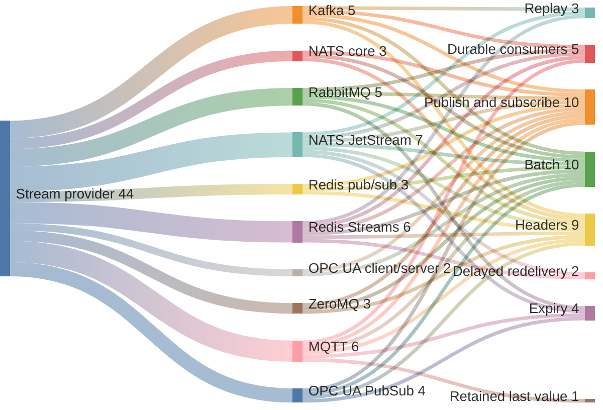
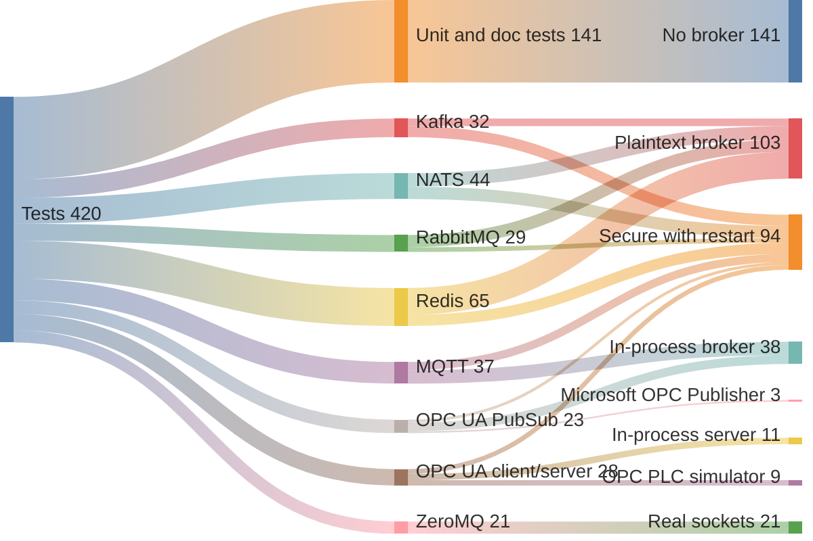

# tpp-streams

Backend-agnostic publish/subscribe streams over Kafka, NATS, RabbitMQ, Redis,
MQTT, ZeroMQ, and OPC UA. A Rust port of [`runtime-go/streams`](https://github.com/the-protobuf-project/runtime-go/tree/main/streams),
built around async traits, explicit capabilities, and caller-owned clients.

## Install

```bash
cargo add tpp-streams --features redis   # or kafka, nats, rabbitmq, mqtt, zeromq, opcua
```

The library is imported as `streams`. Every backend is a Cargo feature, so an
application builds only the clients it talks to; `kafka` compiles librdkafka
from C. `protobuf` adds a prost codec beside the default JSON one.

## Quick start

Start Redis with `docker compose -f streams/docker/compose.redis.yaml up -d --wait`.

```rust
use futures::StreamExt;
use streams::{Options, Stream, Streams, typed,
    drivers::redis::{RedisConfig, RedisProvider, redis}};

#[derive(Debug, serde::Deserialize, serde::Serialize)]
struct Order { user: String, total: u32 }

#[tokio::main]
async fn main() -> Result<(), Box<dyn std::error::Error>> {
    let client = redis::Client::open("redis://127.0.0.1:16380")?;
    let provider = RedisProvider::new(client, RedisConfig {
        prefix: "demo".into(), ..RedisConfig::default()
    });
    let stream = provider.create(
        Stream::named("orders")
            .subjects(["order.placed"])
            .header("lang", "rust"),
    ).await?;

    let orders = typed::<Order>(provider.bind(&stream.id).await?);
    let mut placed = orders.subscribe("order.placed", &Options::default()).await?;
    orders.publish("order.placed", &Order { user: "ada".into(), total: 42 }, &Options::default()).await?;
    println!("{:?}", placed.next().await);
    Ok(())
}
```

## How it fits together

1. **Connect** a client you own and hand it to a provider. Providers never
   close what you gave them.
2. **Create** a stream with the subjects it accepts. Publishing or subscribing
   to anything else fails with `StreamError::UnknownSubject`.
3. **Bind** the stream to get a `Manager`, which publishes and subscribes. A
   subscription is a `futures::Stream`; dropping it ends the subscription.
4. **Reach for a capability** with `as_durable`, `as_positioned`, or
   `as_batch`. A backend that lacks one says so with `StreamError::Unsupported`
   rather than silently giving weaker delivery.

| Capability | Kafka | NATS | RabbitMQ | Redis | MQTT | ZeroMQ | OPC UA |
| --- | :---: | :---: | :---: | :---: | :---: | :---: | :---: |
| Publish / Subscribe | Yes | Yes | Yes | Yes | Yes | Yes | Write / monitored item |
| Durable (ack / nak) | Yes | JetStream | Yes | Streams | Persistent session | No | No |
| Positioned replay | Yes | JetStream | No | Streams | No | No | No |
| Batch | Native | Pipelined (JetStream) | Pipelined | Pipelined | Pipelined | Each | One Write |
| Headers | Record headers | NATS headers | AMQP headers | Stream fields; frame v2 on pub/sub | MQTT 5 user properties | Frame v2 | PubSub only (user properties) |
| Expiry | No | JetStream (whole seconds) | Yes (at the head of the queue) | No | Yes (whole seconds) | No | PubSub only |
| Retain (last value) | No | No | No | No | Yes | No | No |
| Delayed nak | No | JetStream | No | Streams (up to the reclaim interval) | No | No | No |

## From one provider to every transport



## Test coverage



Payloads are framed byte-for-byte as runtime-go frames them, and every broker
driver keeps Go's topic, key, and metadata layout, so Go and Rust services can
share one broker. OPC UA is the exception, and Rust only: its values travel as
native typed OPC UA `DataValue`s, so PLCs, SCADA, and other OPC UA tools can
read them.

See [source and middleware](src/README.md), [drivers](src/drivers/README.md),
[examples](examples/README.md), [Docker](docker/README.md), [tests](tests/README.md), and
[benchmarks](benches/README.md).
