# tpp-streams

Backend-agnostic publish/subscribe streams over Kafka, NATS, RabbitMQ, Redis,
MQTT, ZeroMQ, and OPC UA. A Rust port of [`runtime-go/streams`](https://github.com/the-protobuf-project/runtime-go/tree/main/streams),
built around async traits, explicit capabilities, and caller-owned clients.

One stream provider, one contract, and every transport behind it: code that
publishes and subscribes through `streams` moves from Kafka to MQTT, or adds
NATS beside RabbitMQ, by changing which provider it builds and nothing else.

## Contents

- [Install](#install)
- [Quick start](#quick-start)
- [Architecture](#architecture)
- [From one provider to every transport](#from-one-provider-to-every-transport)
- [The contract](#the-contract)
- [Lifecycles and states](#lifecycles-and-states)
- [Messages, codecs and the wire](#messages-codecs-and-the-wire)
- [Headers](#headers)
- [Options](#options)
- [Delivery guarantees](#delivery-guarantees)
- [Configuration](#configuration)
- [Security](#security)
- [Errors](#errors)
- [Middleware and typed views](#middleware-and-typed-views)
- [Generated topics](#generated-topics)
- [Interoperating with runtime-go](#interoperating-with-runtime-go)
- [Further reading](#further-reading)

## Install

```bash
cargo add tpp-streams --features redis   # or kafka, nats, rabbitmq, mqtt, zeromq, opcua
```

The library is imported as `streams`. Every backend is a Cargo feature, so an
application builds only the clients it talks to.

| Feature | Adds | Client crate |
| --- | --- | --- |
| `kafka` | Kafka | `rdkafka` (librdkafka, compiled from C) |
| `nats` | NATS core and JetStream | `async-nats` |
| `rabbitmq` | RabbitMQ (AMQP 0-9-1) | `lapin` |
| `redis` | Redis pub/sub, scheduled delivery, Streams | `redis` |
| `mqtt` | MQTT 5 | `rumqttc` |
| `zeromq` | ZeroMQ PUB/SUB | `zeromq` (pure Rust) |
| `opcua` | OPC UA client/server and PubSub over MQTT | `async-opcua` (pure Rust); enables `mqtt` |
| `protobuf` | the `Protobuf` codec | `prost` |
| `tls` | TLS for Redis and Kafka (the others carry rustls already) | `redis` rustls, vendored OpenSSL for librdkafka |

## Quick start

Start Redis with `docker compose -f streams/docker/compose.redis.yaml up -d --wait`.

```rust
use futures::StreamExt;
use streams::{Options, Stream, Streams, typed,
    drivers::redis::{RedisConfig, RedisProvider, redis}};

#[derive(Debug, serde::Deserialize, serde::Serialize)]
struct Order { user: String, total: u32 }

#[tokio::main]
async fn main() -> Result<(), Box<dyn std::error::Error>> {
    let client = redis::Client::open("redis://127.0.0.1:16380")?;
    let provider = RedisProvider::durable(client, RedisConfig {
        prefix: "demo".into(), ..RedisConfig::default()
    });

    let stream = provider.create(
        Stream::named("orders")
            .subjects(["order.placed"])
            .header("lang", "rust"),
    ).await?;

    let orders = typed::<Order>(provider.bind(&stream.id).await?);
    let mut placed = orders.subscribe("order.placed", &Options::default()).await?;
    orders.publish(
        "order.placed",
        &Order { user: "ada".into(), total: 42 },
        &Options::default().header("traceparent", "00-4bf92f3577b34da6-00f067aa0ba902b7-01"),
    ).await?;
    println!("{:?}", placed.next().await);
    Ok(())
}
```

## Architecture

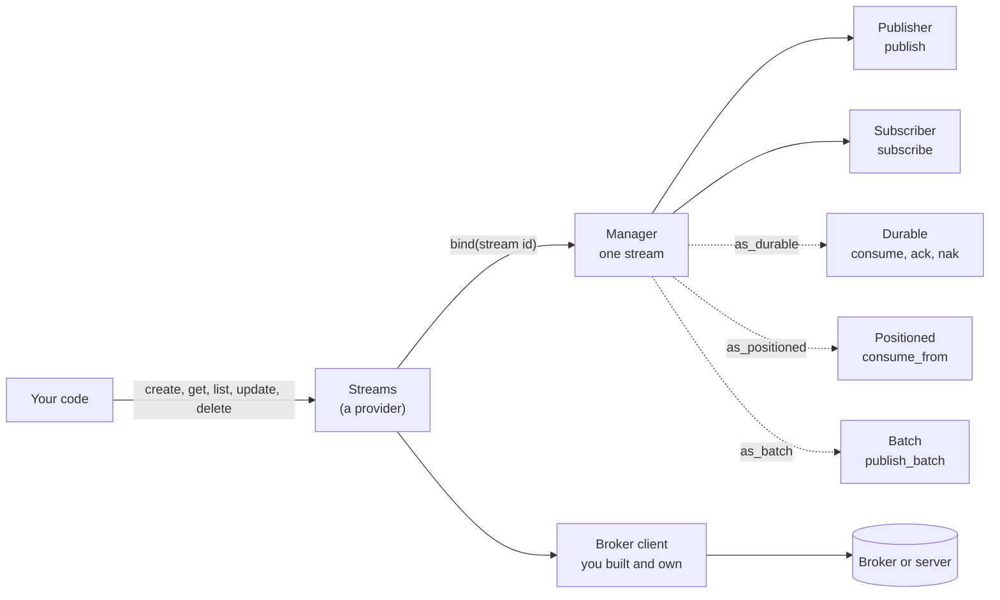

1. **Connect** a client you own and hand it to a provider. Providers never
   close what you gave them; `Streams::close` releases only what the provider
   opened itself.
2. **Create** a stream with the subjects it accepts. Publishing or subscribing
   to anything else fails with `StreamError::UnknownSubject`, so a typo fails
   loudly instead of producing a topic nobody reads.
3. **Bind** the stream to get a `Manager`, which publishes and subscribes.
4. **Reach for a capability** with `as_durable`, `as_positioned`, or
   `as_batch`. A backend that lacks one says so with `StreamError::Unsupported`
   rather than silently giving weaker delivery.

## From one provider to every transport

The same stream provider, carried by each transport. A band's width is the
number of capabilities that transport really supports.

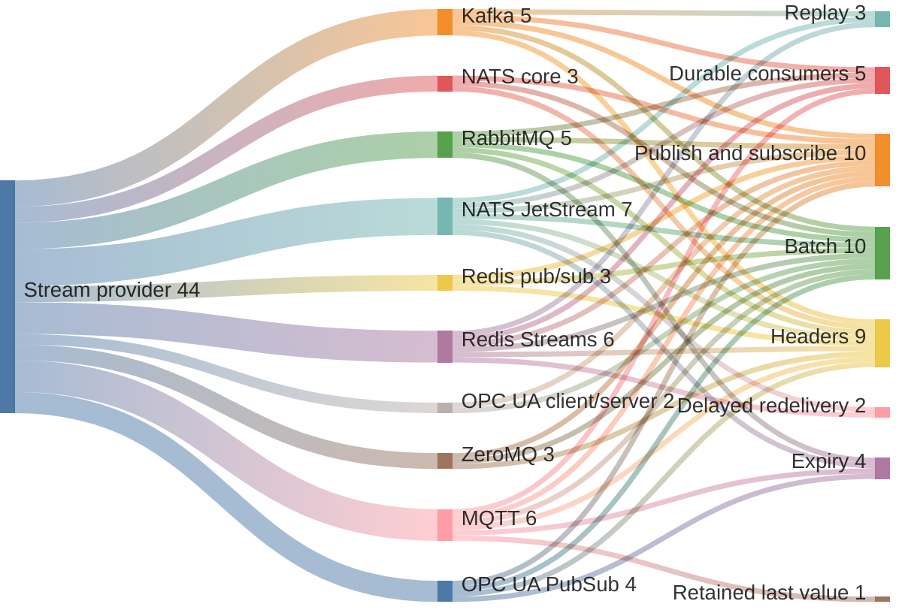

| Capability | Kafka | NATS | RabbitMQ | Redis | MQTT | ZeroMQ | OPC UA |
| --- | :---: | :---: | :---: | :---: | :---: | :---: | :---: |
| Publish / Subscribe | Yes | Yes | Yes | Yes | Yes | Yes | Write / monitored item |
| Durable (ack / nak) | Yes | JetStream | Yes | Streams | Persistent session | No | No |
| Positioned replay | Yes | JetStream | No | Streams | No | No | No |
| Batch | Native | Pipelined (JetStream) | Pipelined | Pipelined | Pipelined | Each | Sequential writes |
| Headers | Record headers | NATS headers | AMQP headers | Stream fields; frame v2 on pub/sub | MQTT 5 user properties | Frame v2 | PubSub only (user properties) |
| Expiry | No | JetStream (whole seconds) | Yes (at the head of the queue) | No | Yes (whole seconds) | No | PubSub only |
| Retain (last value) | No | No | No | No | Yes | No | No |
| Delayed nak | No | JetStream | No | Streams (up to the reclaim interval) | No | No | No |
| Work shared by | Consumer group | Queue group (core); durable name (JetStream) | Durable name | Durable name | `$share/` | No | PubSub only (`$share/`) |
| Delayed delivery (`ttl`) | No | No | No | Scheduled provider | No | No | No |

## The contract

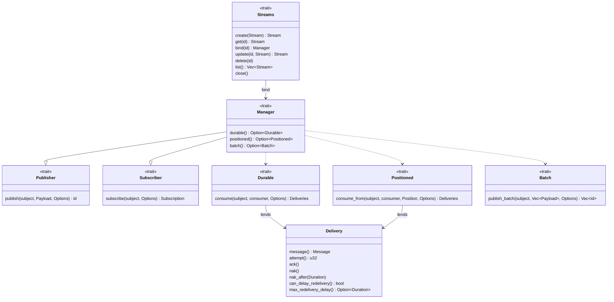

- `Publisher` and `Subscriber` are the honest intersection of every backend:
  send a payload, receive it, no promise that it survives a restart.
- `Durable`, `Positioned` and `Batch` are everything past that, and a provider
  exposes one only where its broker really has it. `as_durable(manager)`
  returns it or an `Unsupported` error that says what to reach for instead.
- A `Subscription` and a `Deliveries` are `futures::Stream`s. Dropping one is
  how it ends.

## Lifecycles and states

### A stream

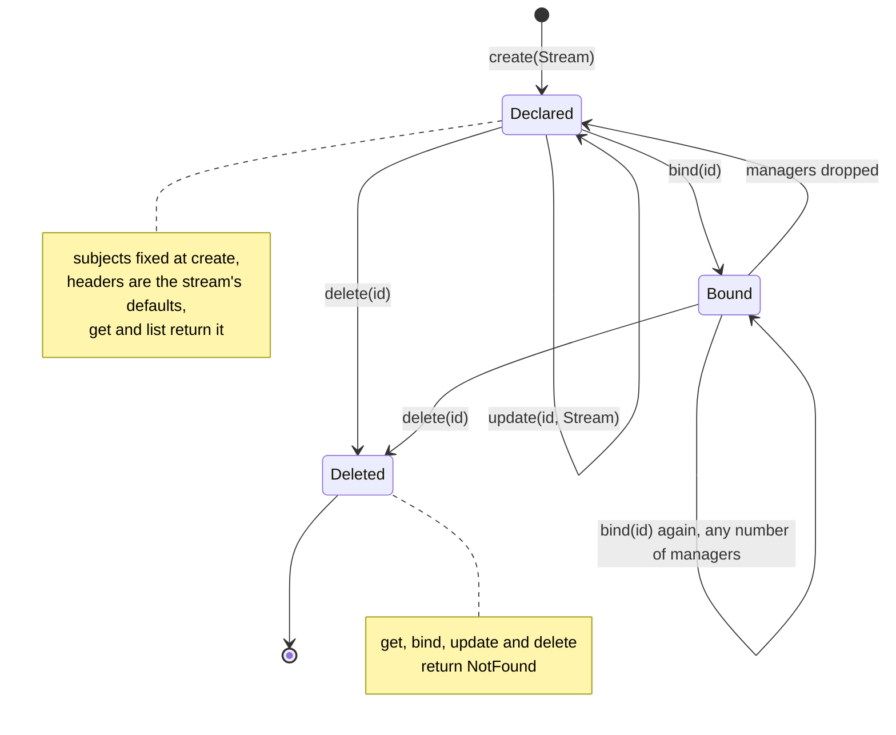

Where the declaration is kept depends on the backend: Kafka in a compacted
metadata topic, JetStream in the stream's own metadata, Redis in a metadata
key, and core NATS, RabbitMQ, MQTT, ZeroMQ and OPC UA in the provider's
process, as runtime-go keeps them.

### A subscription

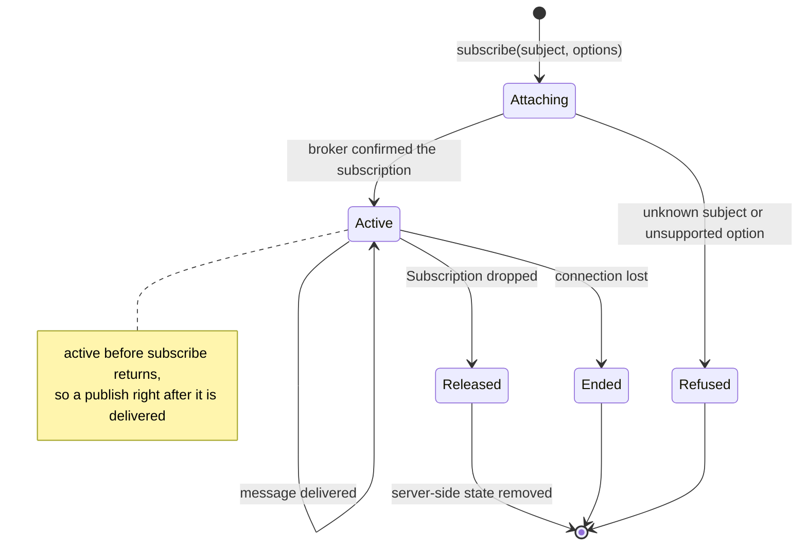

A plain subscription delivers at most once: a message published while nothing
listens, or lost with a connection, is gone. Durable consumers exist for the
cases where that matters.

### A durable delivery

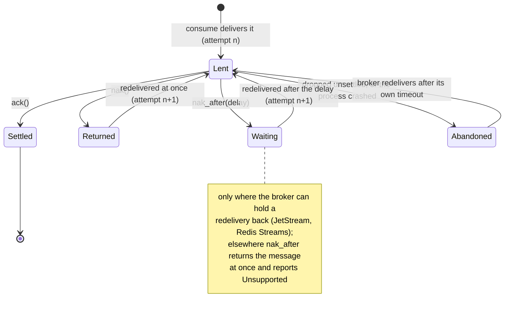

A durable consumer is named, and the name is the identity that survives a
restart: two processes consuming under one name share the work, and a process
that comes back resumes where the name left off.

### A connection

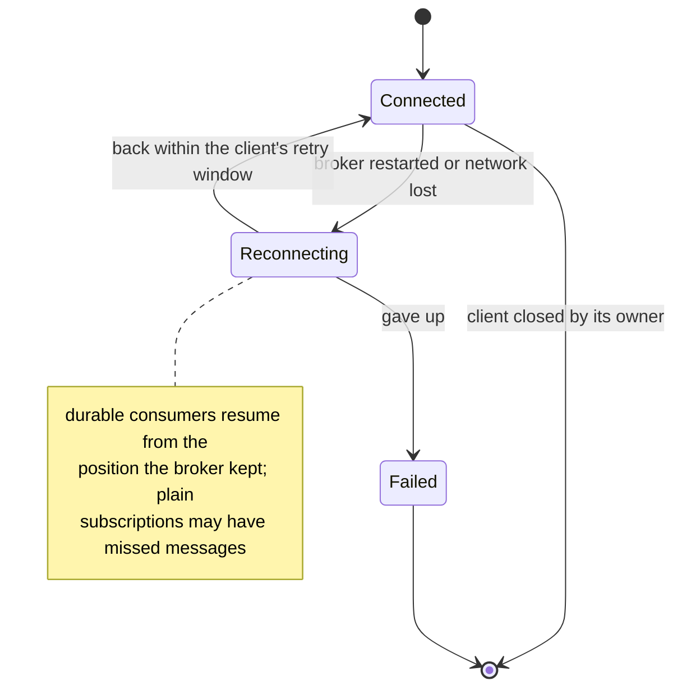

### Publishing

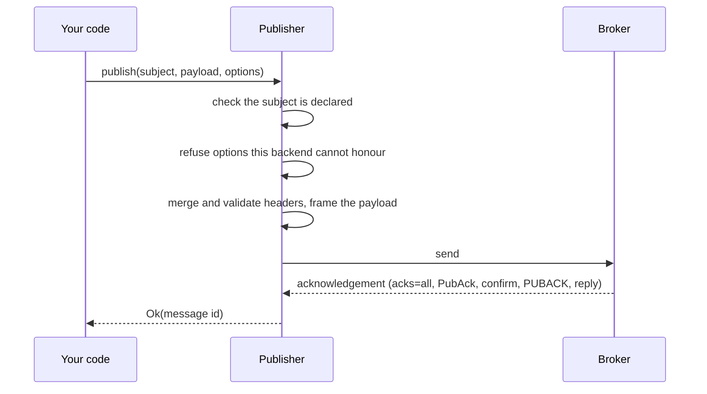

`publish` returns only once the broker has the message. A publish that is
retried after a lost acknowledgement may be stored twice; pin `Options::id` so
consumers can recognise the duplicate.

### Consuming durably

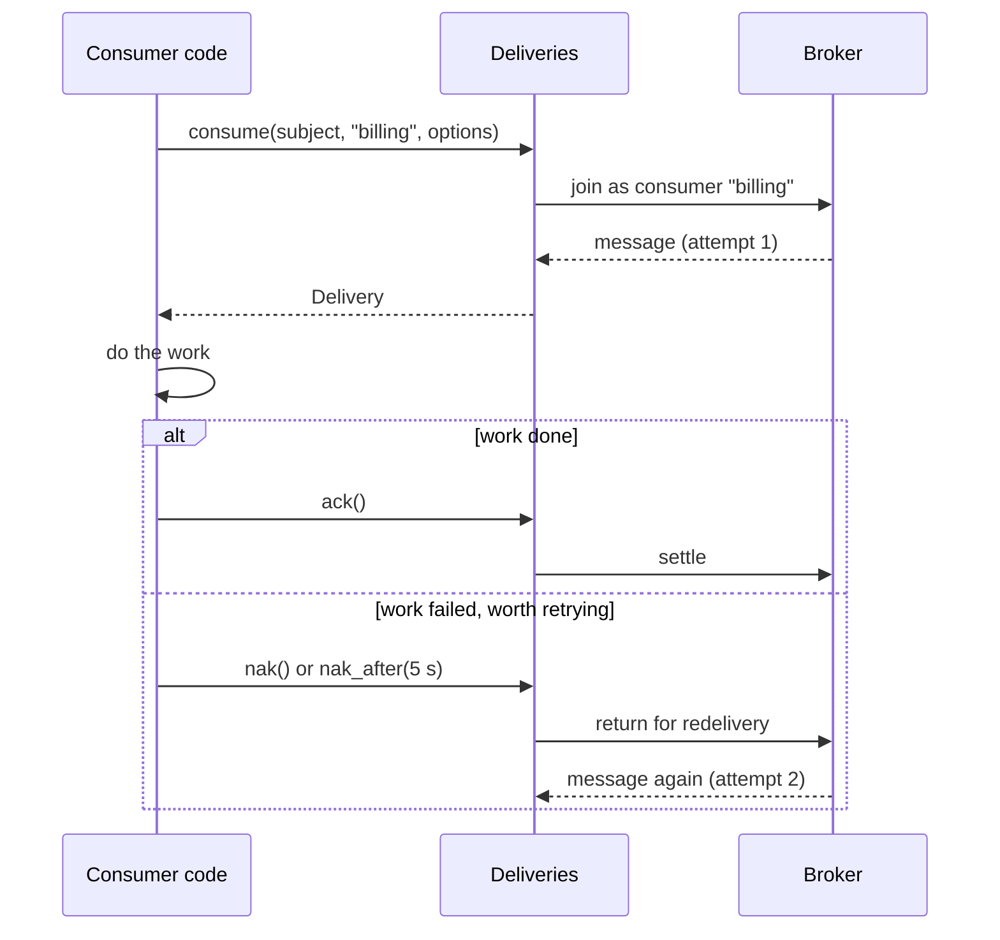

## Messages, codecs and the wire

There is no message type on the publish path. A value is encoded by a `Codec`
into a `Payload` (bytes plus the codec's name), and a delivered `Message`
stays encoded until you decode it into your own type.

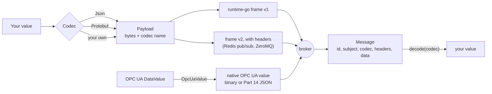

| Codec | Name on the wire | Encodes |
| --- | --- | --- |
| `Json` | `json` | any `serde` type (always accepted) |
| `Protobuf` | `protobuf` | any `prost::Message` (feature `protobuf`) |
| `OpcUaValue` | `opcua.datavalue` | OPC UA `DataValue` and `Variant` |
| your own | any name | implement `Codec<T>`, or wrap bytes with `Payload::from_parts(name, bytes)` |

A receiver accepts only the codec names in its `Registry` (JSON always), and a
frame naming any other is refused when it arrives rather than handed over as
bytes nobody can read. Decoding with a codec the publisher did not use fails
with `Unsupported`, naming both.

Every broker driver frames the payload exactly as runtime-go does:

```text
version 1   0xB7 | 0x01 | uvarint len | codec name | uvarint len | message id | data
version 2   0xB7 | 0x02 | uvarint len | codec name | uvarint len | message id
                        | uvarint count | (uvarint len | key | uvarint len | value) * count | data
```

Version 2 is written only by transports with no header mechanism of their own
(Redis pub/sub and scheduled, ZeroMQ), and only when there are headers to
carry. A message without headers is always version 1, which runtime-go reads.

## Headers

Headers are a plain string-to-string map that travels beside the payload, for
anything a deployment wants to say about a message: the language that produced
it, a trace, a content type, a site. There is no schema and no key this crate
reserves.

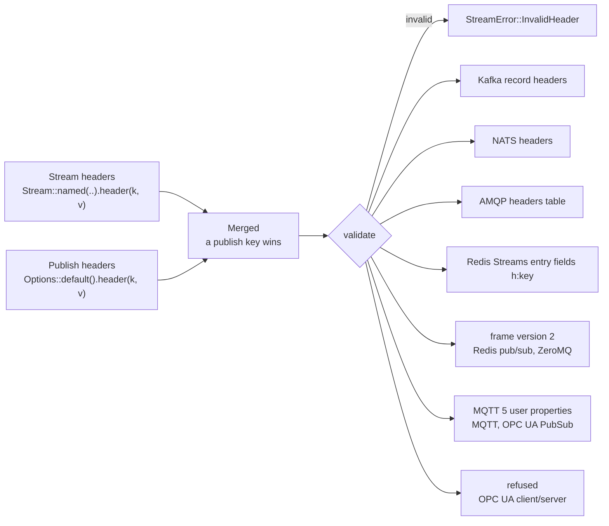

```rust
// Defaults for every message published through the stream.
let stream = provider.create(
    Stream::named("telemetry")
        .subjects(["sensor.reading"])
        .header("lang", "rust")
        .headers([("site", "plant-3"), ("team", "facilities")]),
).await?;

// A publish's own, laid over the stream's.
manager.publish("sensor.reading", payload,
    &Options::default().header("site", "plant-4").header("traceparent", trace)).await?;

// On the receiving side.
message.headers().get("site");          // Some("plant-4")

// Low level.
let mut h = Headers::new();
h.insert("lang", "rust");
h.extend([("site", "plant-3")]);
h.remove("site");
for (key, value) in &h { /* ... */ }
```

| Rule | Value |
| --- | --- |
| Key | non-empty, visible ASCII, no `:`, at most 256 bytes (`MAX_KEY`) |
| Value | one line of text, no control characters, at most 4,096 bytes (`MAX_VALUE`) |
| All headers of one message | at most 16 KiB together (`MAX_TOTAL`) |
| Reserved by a broker | `Nats-*` on NATS; `x-*`, `CC`, `BCC` on RabbitMQ |
| Stored | with the stream's metadata, omitted when empty, so runtime-go still reads it |
| Checked | at `create`, `update`, `publish` and `publish_batch`, failing at the call that set it |

## Options

`Options` carries per-call settings, built with chained methods. A setting that
only tunes delivery is ignored where a backend cannot honour it; a setting that
changes what the call means is refused with `Unsupported`.

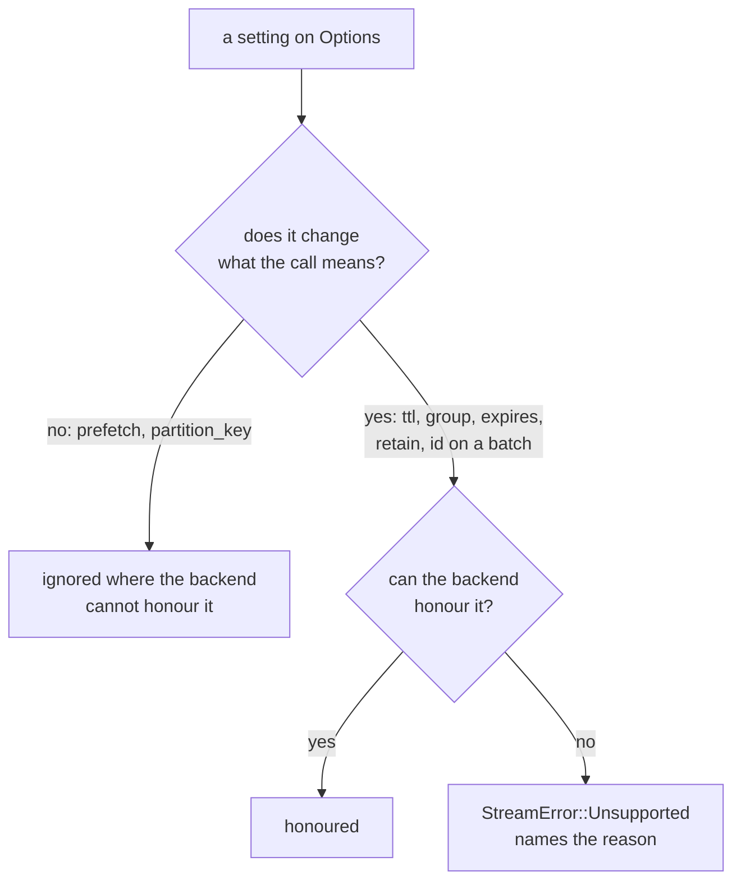

| Builder | Field | Meaning |
| --- | --- | --- |
| `with_id(id)` | `id` | publish under this id instead of a generated ULID |
| `with_group(name)` | `group` | share the subject among subscribers in a group |
| `with_prefetch(n)` | `prefetch` | messages a provider may hold ahead of the reader (default 64) |
| `with_partition_key(k)` | `partition_key` | order this message with every other carrying the same key (Kafka) |
| `with_ttl(d)` | `ttl` | delay delivery by `d` (Redis scheduled provider) |
| `with_expiry(d)` | `expires` | drop the message if it is not delivered within `d` |
| `with_retain()` | `retain` | keep the message as its subject's last value (MQTT) |
| `header(k, v)` / `headers(..)` | `headers` | this publish's headers |

## Delivery guarantees

| | Plain subscription | Durable consumer |
| --- | --- | --- |
| Delivery | at most once | at least once |
| Survives a consumer restart | no | yes, by consumer name |
| Survives a broker restart | no | yes, on a durable broker configuration |
| Redelivery | none | after `nak`, after a timeout, or after a crash |
| Duplicates | none | possible after a crash or a rebalance; pin ids to detect them |
| Ordering | per subject, as the broker orders | per partition (Kafka), per subject (others) |

A `publish` that returns `Ok` has been accepted by the broker under the
backend's strongest acknowledgement: Kafka `acks=all` with idempotence, a
JetStream PubAck, a RabbitMQ publisher confirm, an MQTT PUBACK at QoS 1, an
answered Redis command. Core NATS and ZeroMQ have no acknowledgement; a
publish there returns once the message is on its way.

## Configuration

Every provider takes the client you built (for Kafka and MQTT, the client
options it builds each connection from) and a configuration struct whose
`Default` is the recommended setting.

### Kafka: `KafkaProvider::connect(ClientConfig, KafkaConfig)`

| Field | Default | Meaning |
| --- | --- | --- |
| `prefix` | empty | namespaces every topic, so independent sets share a cluster |
| `partitions` | 1 | partitions per subject topic: the unit of parallelism and ordering |
| `replication_factor` | 1 | brokers holding each topic; raise it on a real cluster |
| `producers` | 8 | producers publishes are spread over; a keyed message always uses the same one |
| `registry` | JSON | codec names this program decodes |
| `metrics` | none | delivery instruments for durable consumers |

The producer copy gets `acks=all`, `enable.idempotence=true` and batching
defaults unless your `ClientConfig` sets them.

### NATS: `NatsProvider::new(Client, NatsConfig)` and `JetStreamProvider::new(Client, NatsConfig)`

| Field | Default | Meaning |
| --- | --- | --- |
| `queue_group` | none | a queue group every core subscription joins |
| `ack_wait` | server default (30 s) | how long a durable delivery may stay unsettled |
| `max_deliver` | server default (unlimited) | deliveries of one message before JetStream gives up |
| `inactive_threshold` | client default (30 s) | how long an idle subscription's consumer lives on the server |
| `registry` | JSON | codec names this program decodes |
| `meter` | none | where durable deliveries are counted |

### RabbitMQ: `RabbitProvider::new(Arc<Connection>, RabbitConfig)`

| Field | Default | Meaning |
| --- | --- | --- |
| `prefix` | empty | namespaces every exchange and queue |
| `prefetch` | 32 | unacknowledged messages one consumer may hold (`basic.qos`) |
| `publish_channels` | 4 | confirm-mode channels single publishes are spread over |
| `registry` | JSON | codec names this program decodes |
| `metrics` | none | delivery instruments for durable consumers |

### Redis: `RedisProvider::new` (pub/sub), `::scheduled` (delayed delivery), `::durable` (Streams)

Each takes `(redis::Client, RedisConfig)`.

| Field | Default | Meaning |
| --- | --- | --- |
| `prefix` | empty | namespaces every key |
| `database` | the client's | the database whose expiry events the scheduled provider watches |
| `max_len` | unbounded | approximate cap on messages a durable subject keeps |
| `reclaim_after` | 30 s | how long a message may sit unacknowledged before another consumer takes it; also the longest delayed nak |
| `confirm_acks` | true | whether `ack()` waits for Redis to answer the XACK |
| `connections` | 1 | how many shared connections commands are spread over; raise it (16 to 64) for a TLS Redis with `appendfsync always`, which syncs about once per command per TLS connection |
| `registry` | JSON | codec names this program decodes |
| `metrics` | none | delivery instruments for durable consumers |

### MQTT: `MqttProvider::connect(MqttOptions, MqttConfig)`

| Field | Default | Meaning |
| --- | --- | --- |
| `prefix` | empty | namespaces every topic |
| `qos` | at least once | QoS of every publish and subscription |
| `session_expiry` | 24 h | how long the broker keeps a departed durable consumer's session |
| `client_id` | generated | client id of the publishing connection |
| `publish_timeout` | 10 s | how long a publish waits for its PUBACK |
| `publish_connections` | 1 | connections publishes are spread over, by topic, so each topic keeps its order |
| `registry` | JSON | codec names this program decodes |
| `metrics` | none | delivery instruments for durable consumers |

`MqttProvider::clear_retained(stream, subject)` removes a retained value.

### ZeroMQ: `ZmqProvider::publisher(ZmqConfig)` and `ZmqProvider::subscriber(ZmqConfig)`

| Field | Default | Meaning |
| --- | --- | --- |
| `endpoint` | required | `tcp://host:port` or `ipc:///path`; a publisher may bind port 0 |
| `settle` | 250 ms | how long `subscribe` waits for the subscription to reach the publisher |
| `registry` | JSON | codec names this program decodes |

### OPC UA client/server: `OpcUaProvider::new(Arc<Session>, OpcUaConfig)`

| Field | Default | Meaning |
| --- | --- | --- |
| `publishing_interval` | 100 ms | how often the server sends queued notifications |
| `sampling_interval` | 0 (fastest) | how often the server samples a monitored node |
| `queue_size` | 64 | a monitored item's server-side queue when no prefetch is given |
| `buffer` | 4,096 | notifications a stream holds ahead of its reader |
| `keep_alive_count` | 10 | publishing intervals before a keep-alive |
| `lifetime_count` | 60 | publishing intervals without a request before the server drops the subscription |
| `initial_value` | false | whether a new stream first delivers the node's current value |
| `max_notifications_per_publish` | 1,000 | notifications per Publish response |

A stream's subjects are node ids (`ns=3;s=Temperature`, or the stable
`nsu=<uri>;s=Temperature`, rebound after a reconnect). `publish` writes the
node's Value and returns after the server's Write response; `subscribe` is a
data-change monitored item.

### OPC UA PubSub over MQTT: `PubSubProvider::connect(MqttOptions, PubSubConfig)`

| Field | Default | Meaning |
| --- | --- | --- |
| `publisher_id` | `runtime-rs-<ULID>` | the PublisherId every message is sent under; set a stable one |
| `prefix` | `opcua` | the first topic level |
| `qos` | at least once | QoS of every publish and subscription |
| `client_id` | generated | client id of the first publishing connection |
| `publish_timeout` | 10 s | how long a publish waits for its PUBACK |
| `publish_connections` | 4 | connections, chosen by topic, so each writer keeps its sequence |
| `max_dataset_messages` | 100 | DataSetMessages per NetworkMessage in a batch |
| `metadata_timeout` | 5 s | how long `metadata()` waits for the retained metadata |
| `meter` | none | where sequence gaps are counted |

Messages follow Part 14's JSON mapping on
`opcua/json/data/<PublisherId>/<WriterGroup>/<DataSetWriter>`;
`publish_metadata` sends retained `ua-metadata`, and `sequence_gaps()` counts
missed SequenceNumbers.

## Security

Every backend except ZeroMQ runs over TLS with the broker's own
authentication, and the secure test suites prove plaintext and
unauthenticated connections are refused.

| Backend | Transport security | Authentication tested |
| --- | --- | --- |
| Kafka | TLS (librdkafka, OpenSSL) | mutual TLS; SASL/SCRAM-SHA-512 with ACLs |
| NATS | TLS (rustls) | mutual TLS with NKey, password, or certificate-mapped users, with permissions |
| RabbitMQ | TLS (rustls) | mutual TLS with SASL EXTERNAL: the certificate is the login |
| Redis | TLS (rustls) | mutual TLS with an ACL user restricted to the driver's commands and keys |
| MQTT | TLS (rustls) | mutual TLS with certificate identity, or password with per-user ACLs |
| ZeroMQ | none | the `zeromq` crate implements neither TLS nor CURVE |
| OPC UA | Basic256Sha256 or Aes256Sha256RsaPss, SignAndEncrypt | username and password, application certificate trust |

TLS uses rustls on the `ring` provider throughout; nothing pulls in aws-lc.
OPC UA's RSA policies inherit the `rsa` crate's RUSTSEC-2023-0071 advisory.

## Errors

| Variant | When | Retrying helps |
| --- | --- | --- |
| `NotFound` | no stream under the id | no |
| `UnknownSubject` | the stream does not declare the subject | no |
| `Unsupported` | the backend cannot do what was asked | no |
| `InvalidHeader` | a header the contract or broker refuses | no |
| `Codec` | a value could not be encoded or decoded | no |
| `Frame` | a received payload was not a frame this contract wrote | no |
| `PartialBatch` | some entries of a batch failed; ids for all of them | for the failed entries |
| `Internal` | a broker or connection failure, with context | often |

`StreamError::is_settled()` says whether retrying could ever succeed;
`with_retry` gives up at once on a settled error.

## Middleware and typed views

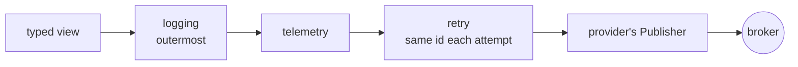

```rust
use std::time::Duration;
use streams::{chain, typed, with_logging_middleware, with_retry_middleware, with_telemetry_middleware};

let publisher = chain(manager.clone(), [
    with_retry_middleware(3, Duration::from_millis(25)),
    with_telemetry_middleware(meter),   // streams_published_total, streams_publish_duration_seconds
    with_logging_middleware(),          // outermost: one line per logical publish
]);
let orders = typed::<Order>(manager).with_publisher(publisher);
```

`chain` makes the last middleware outermost. `typed::<T>` encodes and decodes
JSON, `typed_with(manager, codec)` any codec, and a message that does not
decode is skipped with a warning rather than ending the subscription.

## Generated topics

`streams::topic` is the typed view's richer sibling, and the runtime
[protoc-gen-streams](https://github.com/the-protobuf-project/streams) generates
against. A `Topic<T, C>` is fixed to one subject by a `TopicSpec<T>`: a
`static` holding the subject and every default a publish or receive starts
from, so generated code is constants and the behaviour lives here.

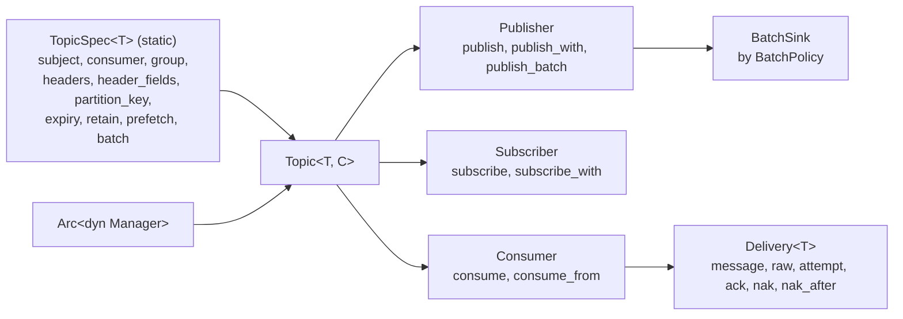

| Item | What it does |
| --- | --- |
| `topic::bind(provider, stream, &[Capability])` | gets the stream, creating it when `NotFound`; adds subjects it lacks (never removes one, which another build may still use); binds it; checks the capabilities with `require` |
| `require(manager, &[Capability])` | fails with the first missing capability's `Unsupported`, in `as_durable`'s, `as_positioned`'s or `as_batch`'s own sentence |
| `Publisher` | lays the spec's key, expiry, retain and headers (static, then read from the message) under the call's own options; `publish_batch` uses `as_batch` and publishes one at a time where it is `Unsupported` |
| `Subscriber` | at most once; a message that does not decode is skipped with a warning |
| `Consumer` | at least once; a delivery that does not decode is acknowledged with a warning, since redelivering it would loop forever |
| `BatchSink` | flushes at `max_size` values or when the oldest has waited `max_delay`; `send_all` flushes on time while its source is idle |

```rust
use std::time::Duration;
use streams::{Capability, Topic, topic::{self, BatchPolicy, TopicSpec}};

fn order_id(order: &Order) -> Option<String> { Some(order.order_id.clone()) }

static PLACED: TopicSpec<Order> = TopicSpec {
    subject: "order.placed",
    consumer: "billing",
    group: None,
    headers: &[("source", "checkout")],
    header_fields: &[],
    partition_key: Some(order_id),
    expiry: None,
    retain: false,
    prefetch: None,
    batch: BatchPolicy { max_size: 100, max_delay: Duration::from_millis(10) },
};

let stream = Stream::named("orders").with_id("orders").subjects(["order.placed"]);
let manager = topic::bind(&provider, stream, &[Capability::Durable]).await?;
let placed: Topic<Order> = Topic::new(manager, streams::Protobuf, &PLACED);
placed.publisher().publish(&order).await?;          // key = order_id, header source
let mut billing = placed.consumer().consume("billing").await?;
```

The codec parameter `C` defaults to `Protobuf` with the `protobuf` feature
and has no default without it, so `Topic<Order>` means the same thing in every
build where it compiles and enabling the feature never changes it; without the
feature write the codec, `Topic<Order, Json>`.

protoc-gen-streams writes one stream type per proto service, its `TopicSpec`
statics from `streams.yaml`, and one accessor per RPC returning a `Topic`, and
depends on this crate with `features = ["protobuf"]`; the generated crate
carries no runtime of its own.

## Interoperating with runtime-go

Go and Rust services can share one broker: the frame, topic names, key
layouts, stream metadata and consumer naming match runtime-go byte for byte.
Publishing from one runtime and consuming in the other was verified in both
directions on Redis, NATS, Kafka and RabbitMQ, and from Go to Rust on MQTT.
Headers ride in each broker's own header mechanism, so a Go peer that does not
read them still reads the payload. OPC UA is Rust only.

## Further reading

- [Source and middleware](src/README.md)
- [Drivers](src/drivers/README.md)
- [Examples](examples/README.md)
- [Local brokers](docker/README.md)
- [Tests](tests/README.md)
- [Benchmarks](benches/README.md)
