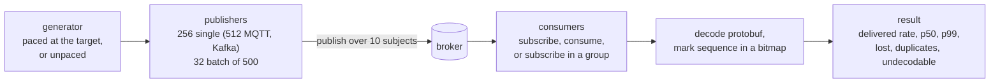
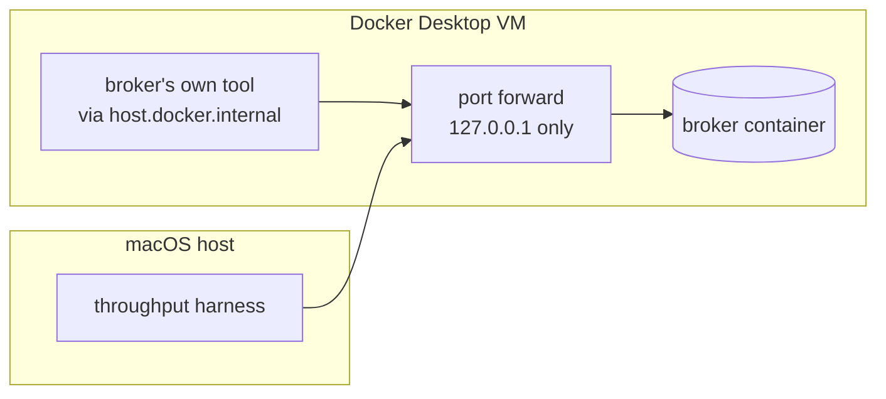
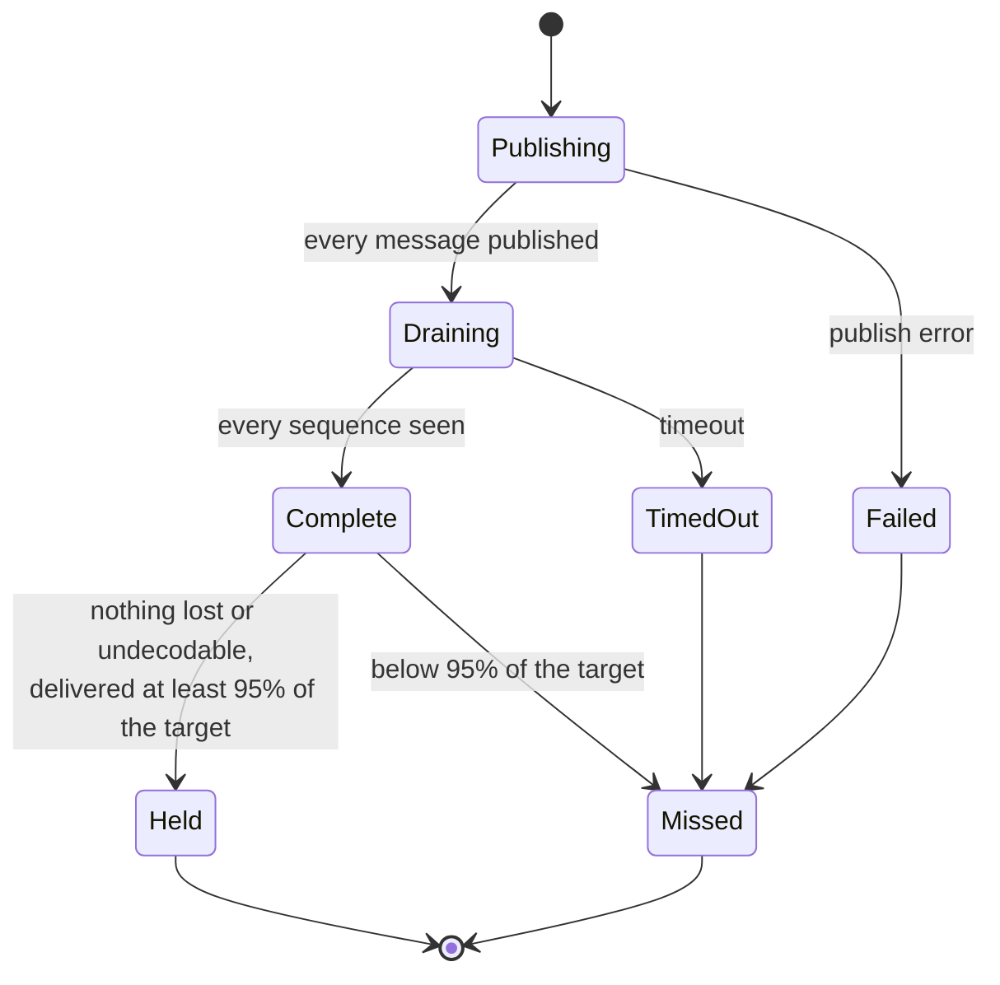
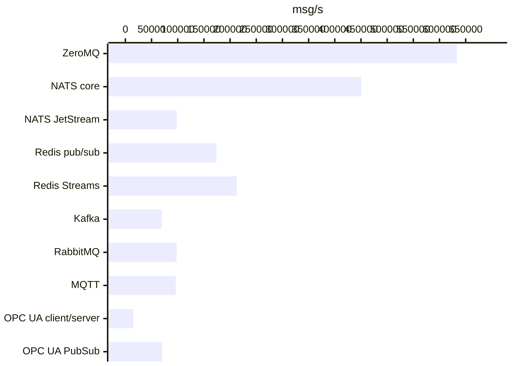
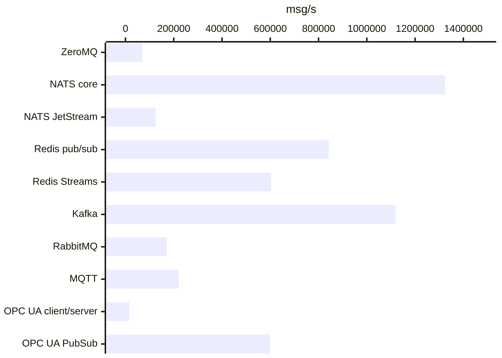
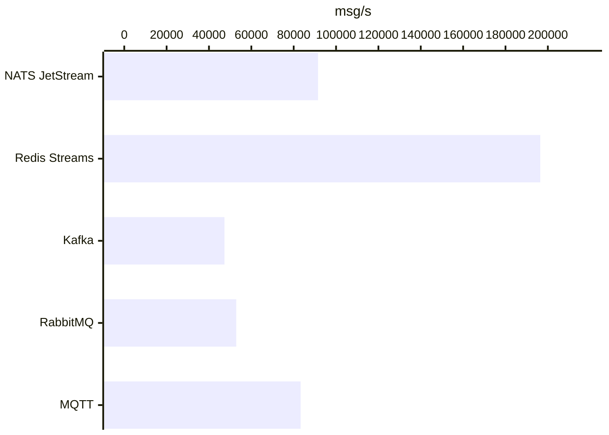
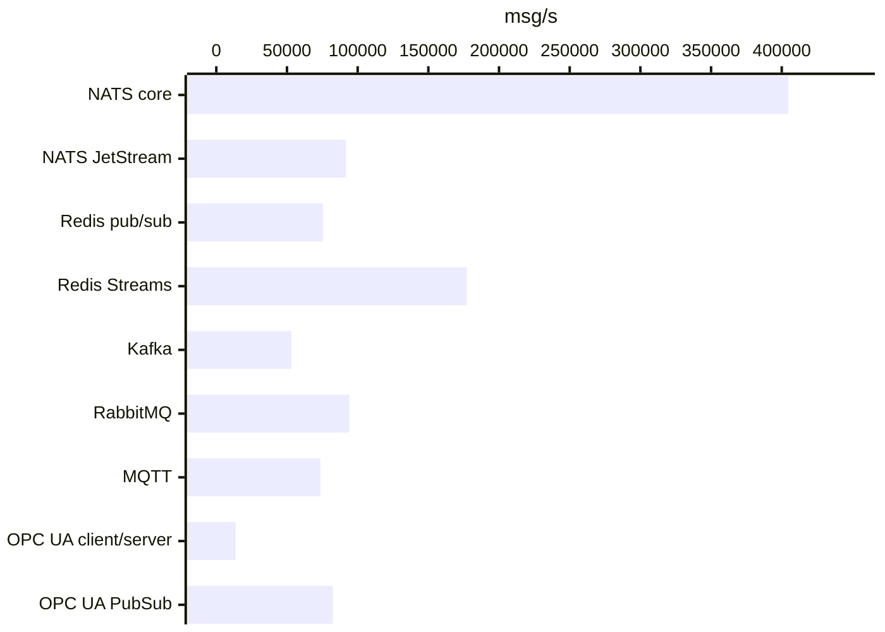
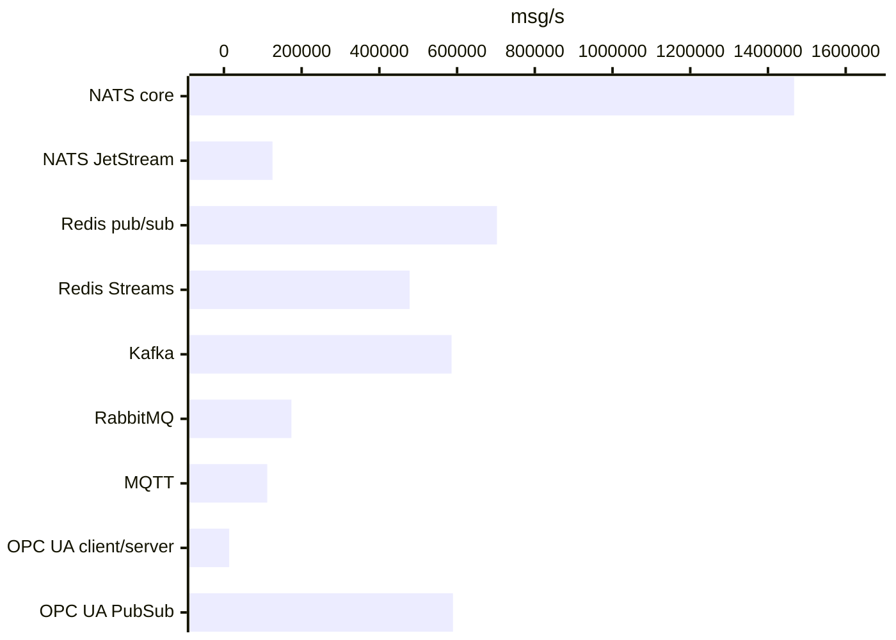
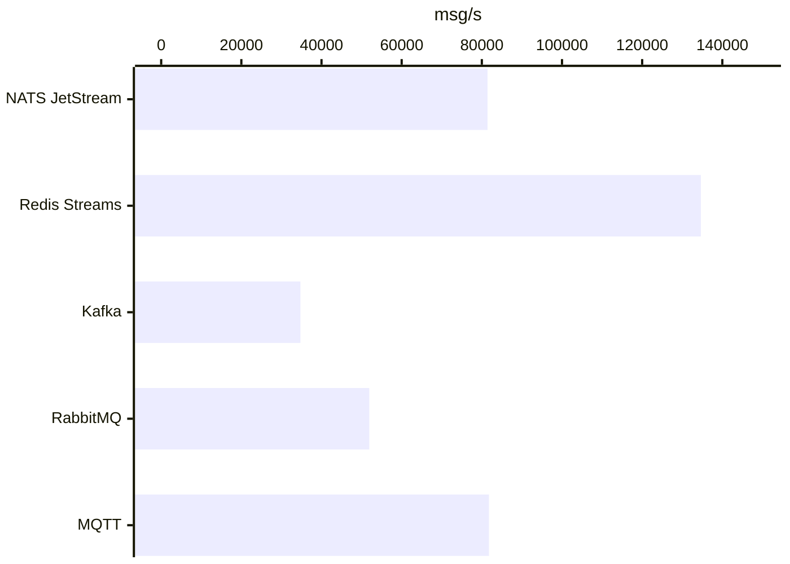

# Throughput benchmark results

[How to run](RUNNING.md) · [Per-backend notes](results/) · [Streams guide](../README.md)

## Run

| | |
| --- | --- |
| Runs | 249 |
| Messages published | 76,100,000 |
| Messages lost | 121,273 |
| Duplicates | 216 |
| Undecodable | 0 |
| Message, single publish | `google.protobuf.StringValue`, 256-byte body, runtime-go frame |
| Message, batch | `google.protobuf.Int64Value`, runtime-go frame, 500 per call |
| Subjects | 10 |
| Paced run | 5 s of messages at the target rate, at least 100,000 |
| Unpaced run | 500,000 messages (20,000 with sync every message) |
| Target held | nothing lost or undecodable, delivered ≥ 95% of the target |
| Host | Apple Silicon Mac, Docker Desktop VM, broker and client on one machine |

## Method

### One run

### Scenarios

| Scenario | Publish | Receive |
| --- | --- | --- |
| fanout | `publish`, one message per call | `subscribe` |
| batch | `publish_batch`, 500 per call | `subscribe` |
| durable | `publish` | `consume` with ack |
| group | `publish` | `subscribe` with a group, consumers sharing each subject |

### Profiles

| Profile | Transport | Broker durability |
| --- | --- | --- |
| plain | plaintext | broker defaults |
| tls-prod | mutual TLS, authenticated | the broker's production default: flushed to disk on its own schedule |
| tls-strict | mutual TLS, authenticated | sync every message to disk before acknowledging |

### Network path

### Judging a run

## Targets held

| Target | Held | Runs |
| --- | ---: | ---: |
| 20,000 msg/s | 52 | 56 |
| 50,000 msg/s | 49 | 56 |
| 100,000 msg/s | 30 | 56 |

## Delivered rate, msg/s

`no` marks a run that did not hold its target.

| Backend | Profile | Scenario | 20k | 50k | 100k | Unpaced | p50 ms at 50k | p99 ms at 50k | Duplicates |
| --- | --- | --- | ---: | ---: | ---: | ---: | ---: | ---: | ---: |
| ZeroMQ | Plaintext | fanout | 19,943 | 49,862 | 99,729 | 633,401 | 0.3 | 2.2 | 0 |
| ZeroMQ | Plaintext | batch | 20,034 | 49,934 | 99,793 | 69,734 no |  |  | 0 |
| NATS core | Plaintext | fanout | 19,947 | 49,868 | 99,757 | 450,360 | 0.5 | 2.8 | 0 |
| NATS core | Plaintext | batch | 20,046 | 49,958 | 99,804 | 1,323,559 |  |  | 0 |
| NATS core | Plaintext | group | 19,949 | 49,869 | 99,739 | 447,218 | 0.5 | 2.4 | 0 |
| NATS core | TLS, production durability | fanout | 19,915 | 49,871 | 99,727 | 404,670 | 0.6 | 5.5 | 0 |
| NATS core | TLS, production durability | batch | 20,044 | 49,958 | 99,836 | 1,467,284 |  |  | 0 |
| NATS core | TLS, production durability | group | 19,947 | 49,883 | 99,741 | 394,826 | 0.5 | 2.0 | 0 |
| NATS core | TLS, sync every message | fanout |  |  |  | 247,343 |  |  | 0 |
| NATS core | TLS, sync every message | batch |  |  |  | 581,414 |  |  | 0 |
| NATS core | TLS, sync every message | group |  |  |  | 273,135 |  |  | 0 |
| NATS JetStream | Plaintext | fanout | 19,946 | 49,982 | 95,490 | 97,964 | 1.0 | 4.2 | 0 |
| NATS JetStream | Plaintext | batch | 20,020 | 49,917 | 99,736 | 124,506 |  |  | 0 |
| NATS JetStream | Plaintext | durable | 19,952 | 49,883 | 92,111 no | 91,506 | 1.1 | 4.4 | 0 |
| NATS JetStream | TLS, production durability | fanout | 19,951 | 49,871 | 92,153 no | 91,628 | 1.1 | 4.3 | 0 |
| NATS JetStream | TLS, production durability | batch | 20,027 | 49,912 | 99,950 | 125,000 |  |  | 0 |
| NATS JetStream | TLS, production durability | durable | 19,950 | 49,982 | 81,949 no | 81,428 | 1.1 | 4.9 | 0 |
| NATS JetStream | TLS, sync every message | fanout |  |  |  | 2,037 |  |  | 0 |
| NATS JetStream | TLS, sync every message | batch |  |  |  | 2,133 |  |  | 0 |
| NATS JetStream | TLS, sync every message | durable |  |  |  | 1,744 |  |  | 0 |
| Redis pub/sub | Plaintext | fanout | 19,993 | 49,984 | 99,925 | 174,197 | 0.7 | 3.1 | 0 |
| Redis pub/sub | Plaintext | batch | 20,033 | 49,946 | 99,794 | 842,238 |  |  | 0 |
| Redis pub/sub | TLS, production durability | fanout | 19,995 | 49,988 | 72,083 no | 75,432 | 0.8 | 2.5 | 0 |
| Redis pub/sub | TLS, production durability | batch | 20,033 | 49,950 | 99,822 | 702,616 |  |  | 0 |
| Redis pub/sub | TLS, sync every message | fanout |  |  |  | 50,465 |  |  | 0 |
| Redis pub/sub | TLS, sync every message | batch |  |  |  | 425,774 |  |  | 0 |
| Redis Streams | Plaintext | fanout | 19,947 | 49,882 | 99,729 | 212,858 | 0.9 | 2.8 | 0 |
| Redis Streams | Plaintext | batch | 20,031 | 49,932 | 99,799 | 604,063 |  |  | 0 |
| Redis Streams | Plaintext | durable | 19,950 | 49,863 | 99,715 | 196,413 | 2.5 | 5.3 | 0 |
| Redis Streams | TLS, production durability | fanout | 19,995 | 49,877 | 99,745 | 177,260 | 1.0 | 3.4 | 0 |
| Redis Streams | TLS, production durability | batch | 20,032 | 49,942 | 99,818 | 478,006 |  |  | 0 |
| Redis Streams | TLS, production durability | durable | 19,949 | 49,855 | 99,420 | 134,636 | 2.8 | 5.9 | 0 |
| Redis Streams | TLS, sync every message | fanout |  |  |  | 23,250 |  |  | 0 |
| Redis Streams | TLS, sync every message | batch |  |  |  | 232,007 |  |  | 0 |
| Redis Streams | TLS, sync every message | durable |  |  |  | 20,545 |  |  | 0 |
| Kafka | Plaintext | fanout | 19,936 | 49,814 | 72,183 no | 69,513 | 5.5 | 43.1 | 0 |
| Kafka | Plaintext | batch | 20,028 | 49,928 | 99,755 | 1,118,949 |  |  | 0 |
| Kafka | Plaintext | durable | 19,916 | 44,252 no | 44,303 no | 47,321 | 11.2 | 41.3 | 80 |
| Kafka | Plaintext | group | 19,932 | 49,763 | 77,610 no | 75,921 | 11.5 | 1898.7 | 0 |
| Kafka | TLS, production durability | fanout | 19,939 | 49,767 | 57,298 no | 53,147 | 7.1 | 63.8 | 0 |
| Kafka | TLS, production durability | batch | 20,021 | 49,893 | 99,772 | 585,784 |  |  | 0 |
| Kafka | TLS, production durability | durable | 19,920 | 38,023 no | 38,672 no | 34,739 | 12.5 | 59.4 | 136 |
| Kafka | TLS, production durability | group | 19,933 | 47,950 | 56,231 no | 54,445 | 11.5 | 1455.5 | 0 |
| Kafka | TLS, sync every message | fanout |  |  |  | 4,938 |  |  | 0 |
| Kafka | TLS, sync every message | batch |  |  |  | 67,592 |  |  | 0 |
| Kafka | TLS, sync every message | durable |  |  |  | 3,274 |  |  | 0 |
| Kafka | TLS, sync every message | group |  |  |  | 7,477 |  |  | 0 |
| RabbitMQ | Plaintext | fanout | 19,946 | 49,988 | 99,492 | 97,896 | 1.1 | 4.5 | 0 |
| RabbitMQ | Plaintext | batch | 20,059 | 50,014 | 99,954 | 171,349 |  |  | 0 |
| RabbitMQ | Plaintext | durable | 19,985 | 41,009 no | 52,962 no | 52,899 | 3.1 | 1414.4 | 0 |
| RabbitMQ | TLS, production durability | fanout | 19,991 | 49,853 | 92,951 no | 94,074 | 1.4 | 4.8 | 0 |
| RabbitMQ | TLS, production durability | batch | 20,057 | 50,017 | 99,961 | 173,770 |  |  | 0 |
| RabbitMQ | TLS, production durability | durable | 19,983 | 49,464 | 52,556 no | 51,918 | 3.1 | 9.4 | 0 |
| RabbitMQ | TLS, sync every message | fanout |  |  |  | 87,744 |  |  | 0 |
| RabbitMQ | TLS, sync every message | batch |  |  |  | 126,576 |  |  | 0 |
| RabbitMQ | TLS, sync every message | durable |  |  |  | 56,292 |  |  | 0 |
| MQTT | Plaintext | fanout | 19,829 | 49,583 | 95,116 | 96,232 | 1.1 | 2.8 | 0 |
| MQTT | Plaintext | batch | 19,902 | 49,632 | 99,185 | 220,965 |  |  | 0 |
| MQTT | Plaintext | durable | 19,822 | 49,586 | 88,383 no | 83,275 | 1.2 | 3.8 | 0 |
| MQTT | Plaintext | group | 19,829 | 49,576 | 82,487 no | 85,810 | 1.4 | 5.1 | 0 |
| MQTT | TLS, production durability | fanout | 19,834 | 49,327 | 80,839 no | 73,652 | 6.5 | 17.6 | 0 |
| MQTT | TLS, production durability | batch | 19,896 | 49,611 | 99,137 | 111,480 |  |  | 0 |
| MQTT | TLS, production durability | durable | 19,832 | 49,558 | 75,931 no | 81,779 | 6.6 | 22.3 | 0 |
| MQTT | TLS, production durability | group | 19,834 | 49,125 | 91,756 no | 92,737 | 1.8 | 21.5 | 0 |
| MQTT | TLS, sync every message | fanout |  |  |  | 53,313 |  |  | 0 |
| MQTT | TLS, sync every message | batch |  |  |  | 83,671 |  |  | 0 |
| MQTT | TLS, sync every message | durable |  |  |  | 50,240 |  |  | 0 |
| MQTT | TLS, sync every message | group |  |  |  | 48,816 |  |  | 0 |
| OPC UA client/server | Plaintext | fanout | 15,061 no | 15,718 no | 15,264 no | 15,084 | 67.2 | 116.4 | 0 |
| OPC UA client/server | Plaintext | batch | 14,704 no | 15,142 no | 15,183 no | 15,437 | 561.7 | 1099.5 | 0 |
| OPC UA client/server | TLS, production durability | fanout | 12,880 no | 13,823 no | 13,794 no | 13,672 | 69.4 | 118.6 | 0 |
| OPC UA client/server | TLS, production durability | batch | 13,526 no | 13,572 no | 13,650 no | 13,641 | 625.2 | 1221.5 | 0 |
| OPC UA PubSub | Plaintext | fanout | 19,827 | 49,543 | 70,348 no | 70,434 | 1.2 | 6.1 | 0 |
| OPC UA PubSub | Plaintext | batch | 19,915 | 49,654 | 99,206 | 598,421 | 4.1 | 7.5 | 0 |
| OPC UA PubSub | Plaintext | group | 19,831 | 49,578 | 65,868 no | 62,620 | 1.5 | 4.6 | 0 |
| OPC UA PubSub | TLS, production durability | fanout | 19,828 | 49,581 | 81,160 no | 82,360 | 3.7 | 17.4 | 0 |
| OPC UA PubSub | TLS, production durability | batch | 19,910 | 49,666 | 99,236 | 589,329 | 4.0 | 7.6 | 0 |
| OPC UA PubSub | TLS, production durability | group | 19,832 | 49,579 | 75,992 no | 76,048 | 1.6 | 14.3 | 0 |
| OPC UA PubSub | TLS, sync every message | fanout |  |  |  | 40,825 |  |  | 0 |
| OPC UA PubSub | TLS, sync every message | batch |  |  |  | 231,077 |  |  | 0 |
| OPC UA PubSub | TLS, sync every message | group |  |  |  | 39,212 |  |  | 0 |

### Unpaced fanout, plaintext, msg/s

### Unpaced batch, plaintext, msg/s

### Unpaced durable, plaintext, msg/s

### Unpaced fanout, tls, production durability, msg/s

### Unpaced batch, tls, production durability, msg/s

### Unpaced durable, tls, production durability, msg/s

## Against each broker's own tool

Same machine, same broker, both through Docker Desktop's port forward.

| Broker | Official tool | Tool msg/s | Our scenario | Our msg/s | Ours ÷ tool |
| --- | --- | ---: | --- | ---: | ---: |
| NATS core | `nats bench` pub + sub, 1 client each | 509,981 | fanout, unpaced | 450,360 | 88% |
| NATS JetStream | `nats bench js pub async`, message ids | 195,332 | batch, unpaced | 124,506 | 64% |
| Kafka | `kafka-producer-perf-test`, acks=all, idempotent | 601,685 | batch, unpaced | 1,118,949 | 186% |
| Kafka | `kafka-consumer-perf-test` | 428,266 | durable, unpaced | 47,321 | 11% |
| RabbitMQ | `perf-test`, persistent, confirm 500, transient queue | 78,394 | batch, unpaced | 171,349 | 219% |
| RabbitMQ | `perf-test`, persistent, confirm 500, durable queue, acks | 48,851 | durable, unpaced | 52,899 | 108% |
| MQTT | `emqtt-bench`, QoS 1, publishers over 10 topics | 33,649 | fanout, unpaced | 96,232 | 286% |

## Against published figures

| Broker | Published | Setup of the published figure | Source | Ours, unpaced plaintext |
| --- | ---: | --- | --- | ---: |
| Kafka | 605 MB/s | 3 brokers, i3en.2xlarge, 1 KB, Kafka 2.6 | [Confluent](https://www.confluent.io/blog/kafka-fastest-messaging-system/) | 1,118,949 msg/s (batch) |
| RabbitMQ | 38 MB/s | mirrored queues, 3 nodes, 1 KB, RabbitMQ 3.8.5 | [Confluent](https://www.confluent.io/blog/kafka-fastest-messaging-system/) | 52,899 msg/s (durable) |
| RabbitMQ | 40,000 msg/s | quorum queue, publisher confirms, 3.8.4 | [RabbitMQ](https://www.rabbitmq.com/blog/2020/05/15/quorum-queues-and-flow-control-stress-tests) | 52,899 msg/s (durable) |
| Mosquitto | 40,000 msg/s | point-to-point, c5.4xlarge | [EMQX](https://www.emqx.com/en/blog/open-mqtt-benchmarking-comparison-mqtt-brokers-in-2023) | 96,232 msg/s (fanout) |
| Mosquitto | 80,000 msg/s | fan-out, c5.4xlarge | [EMQX](https://www.emqx.com/en/blog/open-mqtt-benchmarking-comparison-mqtt-brokers-in-2023) | 96,232 msg/s (fanout) |
| NATS core | 7,670,000 msg/s | 16-byte messages, 1 publisher, no subscriber | [NATS docs](https://docs.nats.io/using-nats/nats-tools/nats_cli/natsbench) | 1,323,559 msg/s (batch) |
| NATS JetStream | ≈250,000 msg/s | R3 file storage, async publish | [community guidance](https://stackoverflow.com/questions/70550060/performance-of-nats-jetstream) | 124,506 msg/s (batch) |

## Before and after each change

| Backend | Change | Measured on | Before | After |
| --- | --- | --- | ---: | ---: |
| MQTT | in-flight and queue limits, request channel | fanout, unpaced | 13,000 | 109,000 |
| MQTT | pipelined batch | batch, unpaced | 14,400 | 230,000 |
| NATS JetStream | pipelined batch | batch, unpaced | 33,400 | 108,000 |
| NATS JetStream | shared reply subscription for PubAcks | publish + ordered consumer | 78,000 | 96,000 |
| RabbitMQ | pool of 4 publishing channels | fanout, 128 publishers | 34,000 | 64,000 |
| RabbitMQ | batch queued before awaiting writes | batch of 500 | 97,000 | 123,000 |
| Redis Streams | read size, combined acks, rarer reclaim | durable, delivered | 12,200 | 84,600 |
| Redis Streams | read coalescing | durable, TLS, 50k paced, 2 consumers | 43,515 | 49,866 |
| Kafka | background offset commits | durable, unpaced |  | 49,600 |
| Kafka | pool of 8 producers | pipelined publish | 114,000 | 598,000 |
| Kafka | new group member starts at subscribe-time end | group, messages lost of 200,000 | 1,018 | 0 |
